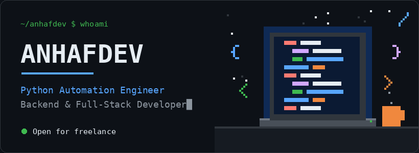
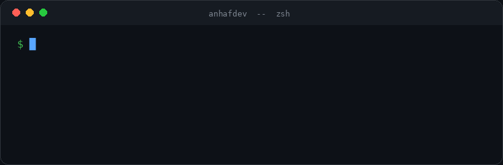
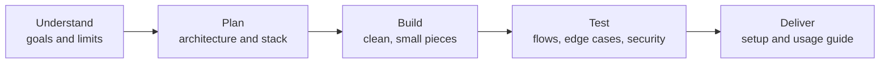

<div align="center">



<br />


<a href="https://github.com/anhafdev?tab=followers"></a>


</div>

<br />

## 👋 About Me

> Every repetitive task is a small theft of human potential. I write code that steals it back.

I'm a **Python Automation Engineer and Full-Stack Developer** who builds software to solve practical problems. I take an idea from requirements to a working, secure solution: designing the logic, connecting APIs and services, and shipping an interface people actually use.

I value clear communication, dependable delivery, and code that stays maintainable after I hand it over.

<div align="center">

| 🧠 Experience | 🌍 Timezone | 🗣️ Languages | ⚡ Response | 🛡️ Security |
| :---: | :---: | :---: | :---: | :---: |
| **3+ years** in production | **UTC+6** (Bangladesh) | **Bangla · English** | Same-day replies | Built in, then tested |

</div>

## 📬 Contact

<div align="center">

<a href="https://t.me/anhafdev"></a>
<a href="mailto:contact@anhaf.dev"></a>
<a href="https://anhaf.dev"></a>

<a href="https://www.fiverr.com/tonmoy_anhaf"></a>
<a href="https://www.upwork.com/freelancers/anhaf?mp_source=share"></a>

</div>

## ⚙️ What I Can Build

<table>
  <tr>
    <td width="50%" valign="top">
      <h3>🤖 Python Automation</h3>
      Custom scripts, browser automation, web scraping, data processing, and workflow automation that removes manual work for good.
    </td>
    <td width="50%" valign="top">
      <h3>🚀 Backend &amp; APIs</h3>
      FastAPI and Flask services, REST APIs, authentication flows, payment logic, and clean integrations between systems.
    </td>
  </tr>
  <tr>
    <td width="50%" valign="top">
      <h3>🌐 Full-Stack Web Apps</h3>
      Responsive frontends in React and Next.js, wired to secure backends, from landing pages to full products.
    </td>
    <td width="50%" valign="top">
      <h3>📨 Bots &amp; Integrations</h3>
      Telegram bots with aiogram, crypto payment and deposit verification, and API-connected tools tailored to your business.
    </td>
  </tr>
</table>

<div align="center">
  <br />
  
</div>

## 📦 Shipped Work

Client details stay private. Here is the kind of work I deliver.

| Project type | What it does | Stack |
| :--- | :--- | :--- |
| ⛴️ **Availability monitor bot** | Watches a booking source around the clock and alerts the client on Telegram the moment a spot opens | `Python` `Playwright` `aiogram` |
| 💰 **Crypto deposit verification** | Self-hosted TXID-based payment checking for BTC and USDT, with no paid third-party services | `FastAPI` `Python` |
| 💬 **AI business assistant bot** | Telegram Business bot that answers customers automatically with an AI backend | `aiogram` `FastAPI` |
| 🔐 **Join-request approver** | Instantly approves channel and group join requests with inline onboarding | `aiogram` |
| 🌾 **Krishok Bondhu** | AI crop-disease assistant for Bangladeshi farmers, built for the Meta AI hackathon | [`Python`](https://github.com/anhafdev/Krishok-Bondhu) |
| 📚 **Git Visual Book** | Animated interactive book teaching Git and GitHub in 28 lessons | [`HTML`](https://github.com/anhafdev/git-visual-book) |

> More details and case studies on **[anhaf.dev](https://anhaf.dev)**

## 🛡️ Security First

Most freelancers build features. I also break them before anyone else can.

- **Implementation:** input validation, authentication, rate limiting, secrets handling, safe payment flows
- **Testing:** manual and tool-assisted checks against common web vulnerabilities before delivery
- **Audits:** review and fixing of AI-generated ("vibe-coded") web apps that ship with hidden security holes

## 🧰 Tech Stack

<div align="center">


<br /><br />


</div>

## 🧩 How I Work



## 💼 Freelance Availability

<div align="center">


</div>

I take on new projects directly. Send me what you need, your goals, and any requirements, and we will agree on scope and approach together.

```python
class FreelanceAvailability:
    status = "OPEN_FOR_HIRE"
    services = [
        "Python automation and scraping",
        "FastAPI backend and API development",
        "Next.js full-stack applications",
        "Telegram bots and crypto payment integrations",
        "Security audits for AI-built web apps",
    ]
    contact = "https://t.me/anhafdev"
```

<div align="center">

<a href="https://t.me/anhafdev"></a>
<a href="https://anhaf.dev"></a>

<br /><br />

<sub>Build with purpose. Automate the repetitive. Create software that matters.</sub>


</div>
